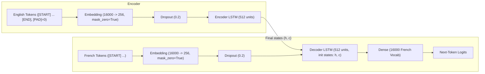
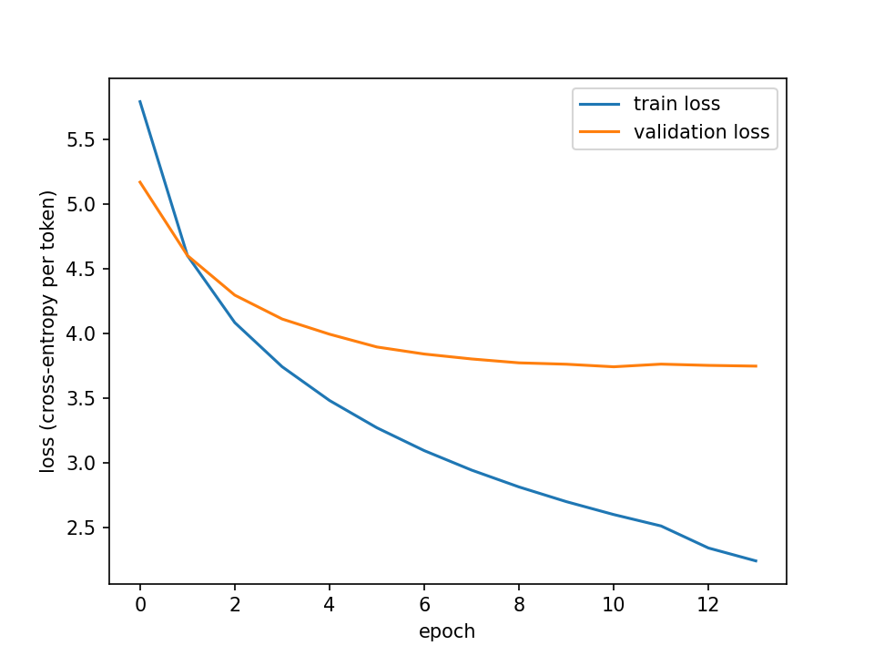

# English-French Neural Machine Translation with an LSTM Encoder-Decoder

Sequence-to-sequence English-to-French neural machine translation built with Keras/TensorFlow, language-specific BPE tokenizers, and length-normalised beam search on IWSLT 2017.

[](https://www.python.org/)
[](https://www.tensorflow.org/)
[](#acknowledgements-and-license)

## Summary

This project implements an English-to-French neural machine translation (NMT) system using a sequence-to-sequence LSTM encoder-decoder in Keras/TensorFlow (`19,549,824` parameters). It trains on the IWSLT 2017 English-French dataset (`iwslt2017-en-fr`) loaded via Hugging Face `datasets`, uses separate 16,000-token Byte-Pair Encoding (BPE) tokenizers built with `tokenizers` for English and French, trains with teacher forcing on a Google Colab GPU, supports both greedy decoding and length-normalised beam search at inference time, and evaluates translation quality with `sacreBLEU`.

## Table of Contents

- [How It Works](#how-it-works)
- [Project Structure](#project-structure)
- [Quick Start](#quick-start)
- [Results](#results)
- [Sample Translations](#sample-translations)
- [Limitations and What I Learned](#limitations-and-what-i-learned)
- [Future Work](#future-work)
- [Acknowledgements and License](#acknowledgements-and-license)

## How It Works



### Architecture and Tokenization

- **Tokenization (`data.py`):** Separate BPE tokenizers (vocabulary size `16,000` each) are trained on the English and French training text using `tokenizers` with `Metaspace` pre-tokenization/decoding and special tokens `[PAD]=0`, `[UNK]=1`, `[START]=2`, and `[END]=3`. Pairs are length-filtered to `0 < len(en) <= 40` and `0 < len(fr) <= 39` (`204,796` of `232,825` training pairs kept; `748` of `890` validation pairs kept).
- **Encoder (`model.py`):** An `Embedding(16000, 256, mask_zero=True)` layer, `Dropout(0.2)`, and an `LSTM(512, return_state=True)` layer returning the final hidden and cell states `(h, c)`.
- **Decoder (`model.py`):** An `Embedding(16000, 256, mask_zero=True)` layer, `Dropout(0.2)`, an `LSTM(512, return_sequences=True, return_state=True)` initialised with `(h, c)`, and a `Dense(16000)` output projection over the French vocabulary.

### Teacher Forcing (Training) vs. Autoregressive Decoding (Inference)

- **Training (Teacher Forcing):** In `train.py`, the decoder takes the ground-truth French sequence shifted by one step (`[START] + french` as `dec_in`, `french + [END]` as `dec_out`) rather than its own predictions. The model minimises `SparseCategoricalCrossentropy(from_logits=True, ignore_class=0)` using `Adam(lr=1e-3, clipnorm=1.0)`, with `ModelCheckpoint`, `CSVLogger`, `EarlyStopping(patience=3, restore_best_weights=True)`, and `ReduceLROnPlateau(factor=0.5, patience=1)` monitoring `val_loss`.
- **Inference (Autoregressive Decoding):** In `model.py` and `translate.py`, the trained layers are exposed as a standalone `encoder_model` (producing `(h, c)` from the source English tokens) and a one-step `step_model` (taking one French token and `(h, c)` and returning logits plus updated `(nh, nc)`). Starting from `[START]`, decoding runs autoregressively up to `max_len=50` steps or `[END]`, supporting both **greedy decoding** (choosing `argmax` at each step) and **beam search** (tracking the top `k` hypotheses).

### Why Length Normalisation Is Used in Beam Search

Each decoding step adds a log-probability ($\le 0$) to a hypothesis's cumulative score, so longer translations accumulate more negative terms and are unfairly penalised relative to shorter ones. In `translate.py`, finished/active beam candidates are ranked by `score / (len(tokens) ** alpha)` with `alpha=0.7`, balancing hypothesis scores across different output lengths so beam search does not systematically favour prematurely short translations.

## Project Structure

```text
.
├── config.py              # Hyperparameters (MAX_LEN=40, VOCAB_SIZE=16000, EMB_DIM=256, UNITS=512, etc.) and run path helpers
├── data.py                # IWSLT 2017 dataset loader, BPE tokenizer training/loading, padding, and tf.data pipelines
├── model.py               # Keras LSTM encoder-decoder training model and weight-sharing inference models
├── train.py               # CLI training script with teacher forcing, gradient clipping, LR scheduling, and plotting
├── translate.py           # Translator class implementing greedy decoding and length-normalised beam search
├── evaluate.py            # Corpus BLEU and chrF evaluation script using sacreBLEU
├── tests.py               # Sanity checks for padding IDs, decoder shift, round-trip tokenization, shapes, and masking
├── chat.py                # Interactive CLI prompt comparing greedy and beam outputs for user input
├── requirments.txt        # Python package dependencies (tensorflow, numpy, datasets, tokenizers, sacrebleu, matplotlib)
├── assets/
│   └── loss_curve.png     # Training and validation loss curve copied from runs/main/loss_curve.png
├── runs/
│   ├── main/              # Final trained run (best.weights.h5, tokenizers, hparams.json, train_log.csv, loss_curve.png)
│   ├── overfit/           # Overfit sanity-test run (drop=0.0, 150 epochs)
│   └── test/              # Tokenizers generated by tests.py
└── old'/                  # Earlier prototype scripts kept for reference
```

## Quick Start

### Installation

Install the dependencies listed in [requirments.txt](file:///home/omarealmaz/tf-env/nmt/requirments.txt) (tested on Python `3.14.4` and TensorFlow `2.22.0-rc1`):

```bash
pip install -r requirments.txt
```

Run the sanity and shape tests:

```bash
python tests.py
```

### Training

Train the model (the `runs/main/` checkpoint was trained on a Google Colab GPU):

```bash
python train.py --run main [options]
```

**Final settings used for `runs/main/`** (from `config.py` and `runs/main/hparams.json`):

| Setting | Value |
| --- | --- |
| `--n` (training pairs) | All (`232,825` raw / `204,796` after length filter) |
| `--batch` | `128` |
| `--epochs` | `20` max (early stopped after epoch `13`; best epoch `10`) |
| `--units` | `512` (with `EMB_DIM = 256`) |
| `--vocab` | `16000` (English & French BPE) |
| `dropout` (`--drop`) | `0.2` |

### Translating Your Own Sentences

Translate a sentence via CLI:

```bash
python translate.py --run main --text "..."
```

Or launch the interactive translation loop:

```bash
python chat.py main
```

### Evaluating

Evaluate greedy and beam (`k=4`) decoding with `sacreBLEU` on 300 sampled test sentences (`SEED = 42`):

```bash
python evaluate.py --run main --split test --n 300
```

## Results



- **Best validation loss:** `3.7425` at epoch `10` (corresponding training loss: `2.6020`; early stopping triggered after epoch `13` with final training loss `2.2444` and validation loss `3.7476`)
- **Test sentences evaluated:** `300` (sampled from the `8,597`-pair IWSLT 2017 `test` split with `SEED = 42`)

### Test Set Evaluation (`sacreBLEU`)

| Decoding Strategy | Beam Width ($k$) | BLEU | chrF | Test Sentences (`N`) |
| --- | --- | --- | --- | --- |
| Greedy | `1` | `7.9` | `29.0` | `300` |
| Beam Search (length-normalised, $\alpha = 0.7$) | `4` | `8.6` | `29.1` | `300` |

### Ablations and Sanity Runs

No formal hyperparameter ablation sweep was run; however, an `--overfit` sanity run (`runs/overfit/`, `drop=0.0`, 150 epochs, `en_tok` vocab `13,457` / `fr_tok` vocab `16,000`) was executed alongside the main run to verify memorisation capacity:

| Run | Dropout | Epochs | Final Train Loss | Best / Final Val Loss | Notes |
| --- | --- | --- | --- | --- | --- |
| `runs/main/` | `0.2` | `14` (`0`–`13`, early stopped) | `2.2444` | `3.7425` (best at epoch `10`) | Full training set (`204,796` filtered pairs) |
| `runs/overfit/` | `0.0` | `150` (`0`–`149`) | `0.0453` | `8.3123` (epoch `0`) / `14.1526` (final) | `--overfit` sanity check (no early stopping) |

## Sample Translations

All examples below are actual outputs from `runs/main/` on the IWSLT 2017 `test` split (`SEED = 42`):

| English Source | Reference (French) | Greedy Output | Beam Output ($k=4$) | Notes / Failure Explanation |
| --- | --- | --- | --- | --- |
| Now, this sounds crazy, right? | Cela paraît incroyable, non? | Ça paraît l'air non ? | Ça sonne bien, n'est-ce pas ? | Short sentence; beam is fluent (`n'est-ce pas ?`) but softens *crazy* to *bien*. |
| This is an amazing story and adventure for you to go on. | Cela devient une histoire extraordinaire et une aventure à vivre. | C'est l'histoire incroyable et de rêver pour vous en rêver. | C'est une histoire incroyable et amusante pour vous joindre. | Captures the opening clause well, then drifts on *for you to go on*. |
| Now we talk about water wars. | Nous parlons des guerres de l'eau. | Maintenant, nous parlons de poissons de guerre. | Maintenant, nous parlons de pollution de pluie. | Failure: preserves sentence structure but hallucinates *poissons de guerre* / *pollution de pluie* for *water wars*. |
| The reason they're often subject to various kinds of surgeries is because they threaten our social categories. | La raison pour laquelle ils subissent souvent différentes opérations est qu'ils menacent nos catégories sociales. | La raison pour laquelle ils sont souvent en train de se faire de leurs intérêts particuliers complexes et des groupes de renseignement inconnues. | La raison pour laquelle ils sont nombreux experts en groupement particulièrement, parce que les systèmes socio-économiques. | Failure: translates the initial clause accurately, then loses semantic alignment in the second half without attention. |
| I didn't know the future of Emma's career, and no one knows the future of work, but I do know this: Identity capital begets identity capital. | Je ne savais pas quel serait la carrière future d'Emma, personne ne connaît son avenir professionnel mais je sais ceci : le capital identitaire génère le capital identitaire. | Je ne savais pas le futur de la comédie ni ni ni ni ni Horge, mais je ne savais pas le fonctionnement du système de la culture de la communication industrielle. | Je ne connaissais pas le futur de la comédie et peut-être pas le cas, mais je ne savais pas que le système de Higgs a la biologie et la collaboration. | Failure: greedy enters a repetition loop (`ni ni ni ni ni`) and both decoders hallucinate unrelated terms from the compressed `(h, c)` state. |
| and never let go -- that small girl now living in San Francisco and speaking to you today? | et ne l'ont jamais lâchée - cette petite fille qui vit maintenant à San Francisco et qui s'adresse à vous aujourd'hui? | et pas seulement ce petit garçon et moi vous regarde de la ville de plus près de quatre ans ? | et ne jamais y aller plus loin, et je me suis demandé pourquoi je vais vous parler de Mars ? | Failure: named entity (*San Francisco*) and subject gender (*small girl*) are lost across the sentence fragment. |
| And so, when you have all sorts of urgent problems, the idea of taking pain now that has to do with a gain later, and a somewhat uncertain pain thing -- in fact, the IPCC report, that's not necessarily the worst case, and there are people in the rich world who look at IPCC and say, "OK, that isn't that big of a deal." | Quand vous avez n'importe quel genre de problème urgent, cette idée de souffrir maintenant, avec un gain plus tard -- par rapport à une douleur dont on n'est pas sûrs. En fait, le rapport du Groupe d’experts Intergouvernemental sur l’Evolution du Climat, ce n'est pas nécessairement le pire des cas, et il ya des gens dans les pays riches qui regardent le GIEC et se disent "Ok, ce n'est pas si important." | Quand vous avez des expériences très intéressantes de ce qui se passe, le premier homme qui a besoin de se faire en quelque sorte -- en particulier le premier rang, et il y a un autre exemple de la souris. | Quand vous avez toutes sortes de choses qui font quelque chose de spécial -- -- à la fin de ce qui se passe à la fin de la journée, nous avons besoin d'une mauvaise idée, pas seulement un doctorat. | Failure: source exceeds `MAX_LEN = 40` tokens and is truncated at inference, while a single `(h, c)` vector cannot retain multi-clause content. |

## Limitations and What I Learned

### Known Limitations

- **Fixed-size context vector (no attention):** The encoder compresses the entire source sequence into a single `(h, c)` state pair (`512` units each), creating an information bottleneck.
- **Long sentences degrade:** Sequences longer than `40` BPE tokens are truncated in `_src`, and multi-clause sentences lose late/middle details in the fixed bottleneck state.
- **Modest BLEU score:** Without attention or Transformer self-attention, test BLEU (`7.9` greedy / `8.6` beam `k=4`) remains modest, with frequent hallucinations on rare phrases and named entities.

### What I Learned

- **BPE & masking hygiene:** Keeping `[PAD]=0` aligned with `Embedding(..., mask_zero=True)` and `SparseCategoricalCrossentropy(..., ignore_class=0)` prevents padding tokens from skewing the loss (`tests.py` verifies `keras_loss == real-token mean`).
- **Training vs. inference separation:** Teacher forcing trains efficiently over full padded sequences, whereas inference requires splitting shared Keras layers into a one-shot `encoder_model` and an autoregressive `step_model`.
- **Beam search & length normalisation:** Length normalisation (`alpha=0.7`) improves test BLEU over greedy decoding (`8.6` vs. `7.9`) by preventing shorter hypotheses from dominating solely due to fewer summed negative log-probabilities.

## Future Work

- **Attention mechanism:** Add Bahdanau or Luong attention so the decoder attends dynamically over all encoder timesteps rather than relying solely on `(h, c)`.
- **Transformer architecture:** Replace the LSTM encoder-decoder with multi-head self-attention and cross-attention to improve long-sentence fidelity and training parallelism.
- **PyTorch version:** Re-implement the pipeline in PyTorch for direct framework comparison and faster batched/custom decoding experimentation.

## Acknowledgements and License

- **Dataset:** [IWSLT 2017 English-French (`IWSLT/iwslt2017`, `iwslt2017-en-fr`)](https://huggingface.co/datasets/IWSLT/iwslt2017)
- **Libraries & Compute:** TensorFlow/Keras (`2.22.0-rc1`), Hugging Face `datasets` (`3.6.0`), Hugging Face `tokenizers` (`0.23.3`), `sacrebleu` (`2.6.0`), `numpy` (`2.5.5`), `matplotlib` (`3.11.2`), and Google Colab GPU
- **License:** No `LICENSE` file is currently present in this repository (add a `LICENSE` file and update the badge at the top if publishing openly).
